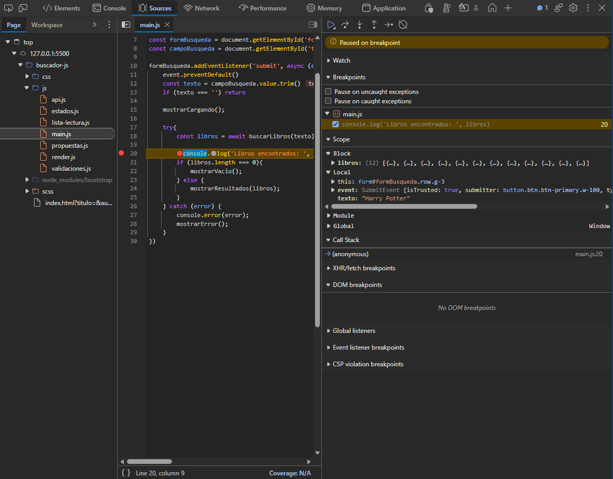
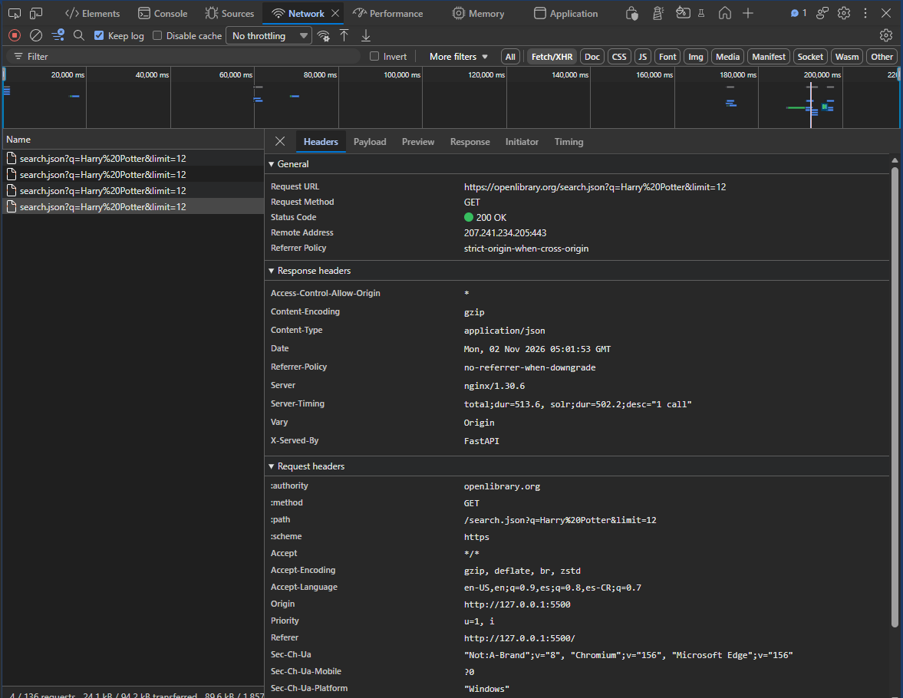
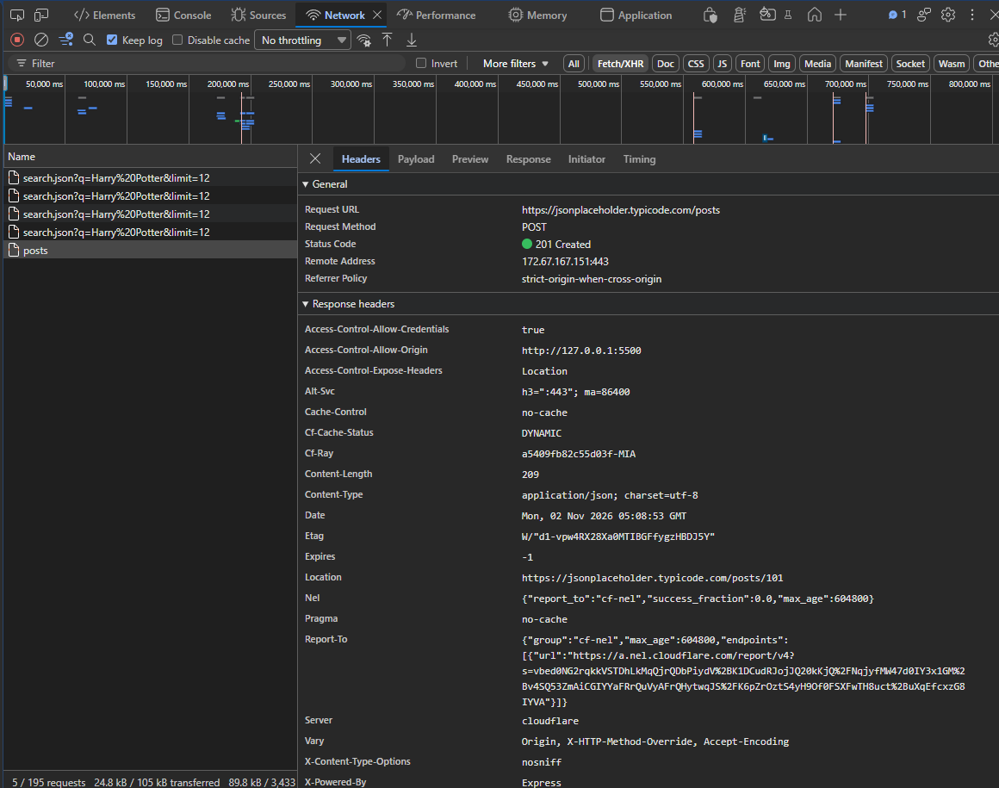

# Depuración y análisis de red

## 1. Objetivo

Verificar el funcionamiento de Estantería Común mediante breakpoints, análisis de solicitudes HTTP y pruebas básicas de la interfaz utilizando las herramientas de desarrollador del navegador.

## 2. Depuración con breakpoints

**Aplicación:** Parte A — Buscador de libros.  
**Archivo:** `buscador-js/js/main.js`.

Se utilizó la pestaña **Sources** de DevTools para colocar un breakpoint en la siguiente línea:

```javascript
const libros = await buscarLibros(texto)
```

Al buscar "Harry Potter", la ejecución se detuvo y se comprobó que la variable `texto` contenía el término ingresado. Posteriormente, se continuó la ejecución y se inspeccionó el arreglo de 12 libros recibido desde Open Library.

**Evidencia:**



## 3. Análisis de solicitudes HTTP

Se utilizó la pestaña **Network**, con el filtro **Fetch/XHR**, para inspeccionar las solicitudes GET y POST de la aplicación.

### Solicitud GET — Open Library

**Endpoint:** `https://openlibrary.org/search.json`

| Elemento | Resultado |
|---|---|
| Búsqueda | Harry Potter |
| Código HTTP | 200 |
| Tiempo de respuesta | 711.14 ms |
| Resultados mostrados | 12 |

La solicitud se completó correctamente. La API devolvió información JSON que incluye un arreglo `docs`, utilizado para generar las tarjetas de libros.



### Solicitud POST — JSONPlaceholder

**Endpoint:** `https://jsonplaceholder.typicode.com/posts`

| Elemento | Resultado |
|---|---|
| Método | POST |
| Content-Type | application/json |
| Código HTTP | 201 |
| Tiempo de respuesta | 652.17 ms |

Se enviaron los datos de una propuesta de lectura mediante `fetch()` y `JSON.stringify()`.

La respuesta devolvió el identificador `id: 101`, confirmando la simulación de creación del recurso. JSONPlaceholder no almacena permanentemente las propuestas.



## 4. Pruebas funcionales

Se revisaron las principales funcionalidades de ambas aplicaciones:

- **JavaScript:** búsqueda de libros, lista de lectura, prevención de duplicados, cambio de estados y eliminación.
- **Formulario de propuestas:** validaciones, campos dinámicos de autores y envío POST.
- **React:** agregar y eliminar libros, cambiar estados, aplicar filtros y actualizar el resumen.

## 5. Conclusiones

El uso de breakpoints permitió inspeccionar variables y comprender el flujo de ejecución de JavaScript.

Mediante Network se verificaron las solicitudes HTTP, sus respuestas y tiempos de ejecución. La búsqueda GET obtuvo un código 200 en 711.14 ms y el envío POST obtuvo un código 201 en 652.17 ms.

Las pruebas funcionales permitieron revisar el comportamiento de las principales características de ambas aplicaciones.
